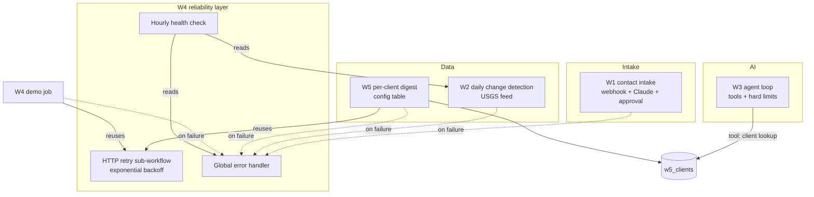

# n8n automation portfolio

Five n8n workflows built around the requirements that keep showing up in AI-automation and integration job posts: webhooks, idempotency, LLM output validation, human approval gates, AI budget limits, change detection at scale, error handling and monitoring, and per-client configuration.

Built on n8n Cloud with n8n Data Tables as the datastore. Public data only (the USGS earthquake API), and sample clients on `example` domains.

## The workflows

| # | Workflow | What it shows | Evidence |
|---|---|---|---|
| W1 | [Contact intake: dedupe + AI triage + approval](docs/w1-README.md) | shared-secret webhook, idempotency key, Claude JSON output validated with one retry, email approval before any reply, per-run token log | logic tested, Claude/Gmail mocked |
| W2 | [Daily change-detection pipeline](docs/w2-README.md) | hash per record, one windowed read instead of per-record lookups, upsert + guarded history, batched alert, daily report, retry + reported failure | **live runs** against the USGS feed |
| W3 | [Tool-using agent with hard limits](docs/w3-README.md) | explicit Claude tool-use loop, max iterations / token budget / timeout, live tools, validated JSON answer, approval before send | loop + tools live, Claude mocked |
| W4 | [Error handling + monitoring](docs/w4-README.md) | global error workflow, reusable retry sub-workflow with exponential backoff, hourly health check | **live production failure** caught and logged |
| W5 | [Per-client configuration](docs/w5-README.md) | one workflow, behaviour driven by a config table; new client = new row; unknown client fails safely into W4 | **live production runs**, new client added with zero edits |

## How they fit together



## Job-requirement map

| Requirement in job posts | Where |
|---|---|
| Webhooks, REST APIs, JSON transformation | W1, W2, W5 |
| Duplicate prevention (same webhook twice, no double reply) | W1 (idempotency key), W2 (rerun = 0 alerts) |
| LLM API with structured output and validation | W1, W3 |
| Human approval before an AI sends anything | W1, W3 |
| Budget caps / runaway-loop prevention for AI | W3 |
| Scheduled pipeline, change detection, history, daily report | W2 |
| Large datasets without checking every record | W2 (windowed hash compare; scaling notes in its README) |
| Error handling, retries, monitoring, failure alerts | W4 (used by W1, W2, W5) |
| Reusable sub-workflows, config per client | W4 retry, W5 |
| Docs to install in under 30 minutes | a README per workflow |
| Tool-using AI agent with limits | W3 |

## Repo layout

```
workflows/   importable JSON exports (no credentials; instance IDs replaced with REPLACE_WITH_... placeholders)
docs/        one README per workflow with setup, test results and known limits; NOT-PROVEN.md
demo/        video script, W1 recording notes, application summary
```

## Credentials

None are in this repo. Workflows reference credentials by type only (Anthropic API, Gmail OAuth2, Header Auth). Placeholder addresses are `you@example.com` and sample `*.example` domains.

## What is not proven

See [docs/NOT-PROVEN.md](docs/NOT-PROVEN.md). In short: no live Claude calls and no real email sends were made.
