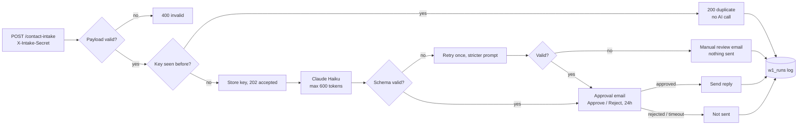

# W1: Contact intake with duplicate protection, AI triage and an approval gate

A contact-form webhook arrives. Claude classifies it and drafts a reply, and a human approves before anything is sent. The same event sent twice is processed once.

## Flow



## Inputs

`POST /webhook/contact-intake`, header `X-Intake-Secret: <secret>`, JSON body:

```json
{ "event_id": "optional-unique-id", "name": "Ana Cruz", "email": "ana@example.com", "subject": "Pricing", "message": "How much for 3 seats?" }
```

Idempotency key: `evt:<event_id>` when present, otherwise `h:sha256(email|subject|message)`.

## Outputs

- HTTP: `202 accepted`, `200 duplicate`, `400 invalid`, or `403` (missing or wrong secret, handled by n8n).
- Data table `w1_runs`: one row per run with `status` (`sent`, `not_sent`, `manual_review`, `duplicate_skipped`), `approver_decision`, `intent`, `urgency`, `tokens_in`, `tokens_out`, timestamps, execution id.
- Data table `w1_seen_events`: the idempotency keys.

## Setup (about 20 minutes)

1. Import `workflows/w1-contact-intake.json` into n8n.
2. Create two data tables:
   - `w1_seen_events`: `idem_key` string, `received_at` date
   - `w1_runs`: `run_id`, `idem_key`, `status`, `intent`, `urgency`, `approver_decision`, `execution_id` strings; `tokens_in`, `tokens_out` numbers; `received_at`, `decided_at` dates
3. Create the credentials and pick them on these nodes:
   - Header Auth (name `X-Intake-Secret`, value: your secret) → **Webhook: Contact Form**
   - Anthropic API → **Claude: Classify + Draft**, **Claude: Retry (strict JSON)**
   - Gmail OAuth2 → the three **Gmail** nodes
4. In **Normalize Payload**, set `sandbox_inbox` to the inbox that receives approvals. Replies go to its `+customer` alias, never to the sender, until you change **Gmail: Send Approved Reply**.
5. Publish, then POST the sample body above.

## Tests

See [w1-results.md](w1-results.md). The logic was tested in n8n test mode with Claude, Gmail and the webhook faked, and everything else running for real. Live runs with real keys were not done.

## Cost per run

Approximate token counts from the test fixtures: about 350 in and 90 out per call, on Claude Haiku with `max_tokens` 600. A retry at most doubles that, and duplicates cost nothing. Every run logs its own token counts to `w1_runs`.

## Known limits

- Dedupe on n8n Data Tables is find-then-insert (no unique constraint): two identical requests within milliseconds could both pass. At scale, use Postgres `INSERT ... ON CONFLICT DO NOTHING`.
- 400 responses are not written to `w1_runs` (they still appear in n8n's execution list).
- The 24h approval timeout is logged as `not_sent` / `timeout`; nobody is notified.
