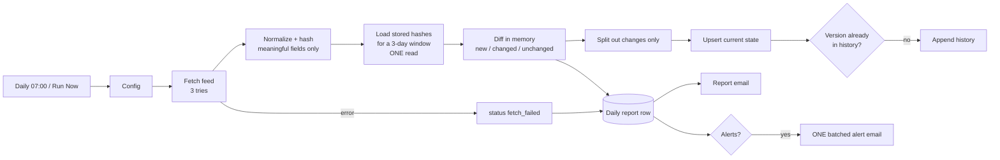

# W2: Daily change-detection pipeline

Watches a public feed for new and changed records without checking records one by one, stores history, and sends one batched alert plus a daily report. The data source is the USGS "all earthquakes, past day" GeoJSON feed: public, no key, and it updates every minute.

## Flow

## Why it scales (the "400,000 records" question)

- **One read per run, not one per record.** Stored hashes are loaded once for a bounded window (`compare_window_days`) and compared in memory. At 400k rows you shard the same idea: partition by key range or time bucket, load one partition's `(id, hash)` pairs (about 40 bytes per row, so 400k rows is roughly 16 MB), diff, and move to the next.
- **Only diffs are written.** A run with no changes writes one report row and nothing else.
- **Hash only what matters.** The hash covers magnitude, place, status and depth, so cosmetic feed updates don't count as changes.
- **Batched writes.** History inserts use n8n's bulk insert, and alerts go out as one email per run, never one per row.
- **Pagination.** The USGS summary feed is a single document with no pages. For a paged API, the HTTP node's built-in pagination (or the FDSN query API's `offset`/`limit`) feeds the same Normalize → Diff chain.

## Data tables

| Table | Columns | Purpose |
|---|---|---|
| `w2_records` | record_id, hash, mag, place, event_time | current state, one row per record (upsert by record_id) |
| `w2_history` | version_key, record_id, change_type, hash, mag, place, detected_at | append-only change log; `version_key = record_id|hash` guards against duplicate rows |
| `w2_reports` | run_at, status, fetched, new_count, changed_count, unchanged_count, alerts_count, error, execution_id | one row per run |

## Config (the `Config` node)

`feed_url`, `alert_min_mag` (4.5), `report_to` (placeholder `you@example.com`), `compare_window_days` (3).

## Setup (about 15 minutes)

1. Import `workflows/w2-change-detection.json`.
2. Create the three data tables above. Use type `number` for mag and the counts, and `date` for event_time, detected_at and run_at.
3. Optional: attach a Gmail OAuth2 credential to the two Gmail nodes and set `report_to`. Without it, the Gmail nodes fail softly (`continueRegularOutput`) and everything else still runs and logs.
4. Click **Run Now (demo)**, or publish the workflow to enable the 07:00 schedule.

## Test results (2026-10-25): live runs against the real USGS feed

Gmail sends were pinned (no credential). Everything else ran for real: the HTTP fetch, hashing, data-table reads and writes, and routing.

| Exec | Test | Result | Pass |
|---|---|---|---|
| 6 | First live run | 182 fetched, 182 new, 182 history rows, 31 alerts in one batch, report saved | yes |
| 7 | Immediate rerun | 0 new, 0 changed, 182 unchanged, 0 alerts; no history written | yes |
| 8 | Forced change: same id `us6000u4r9`, magnitude 6.5 → 6.7 (fed via pinned HTTP data) | 1 `changed`; upsert updated the existing row (id 64, no duplicate); 1 history row; 1 alert | yes |
| 9 | Forced API failure (`feed.invalid` host) | 3 tries (~4 s), error branch, report row `fetch_failed` with `getaddrinfo ENOTFOUND feed.invalid` | yes |
| 10 | Back to the real feed | 181 fetched, 1 changed (the forced 6.7 correctly reverting to the real 6.5), 180 unchanged | yes |

## Known limits

- n8n Data Tables have no unique constraints. The upsert and the history guard handle reruns, but two runs at the same moment could race. Use Postgres unique keys at scale.
- If the upsert succeeds and the history insert then fails, that one history row is lost. Duplicate alerts can't happen, because alerts are computed before any writes and the next run sees the record as unchanged.
- Records older than the compare window that change upstream would be treated as new. USGS's day feed only holds the last 24h, so the 3-day window covers it.
- Email delivery was not tested (no Gmail credential).
