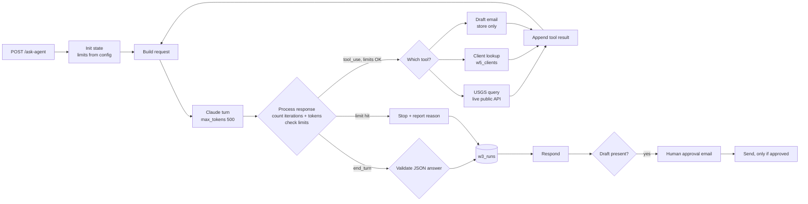

# W3: Tool-using AI agent with hard limits

A research and ops agent that answers questions with three tools, and can never run away. The agent loop is built explicitly, one visible n8n node per step, instead of hidden inside n8n's AI Agent node. That way every limit is enforced and logged by code I can point to.

## The loop

## Hard limits (node **Agent Limits**)

| Limit | Value | Enforced where |
|---|---|---|
| max iterations | 5 model turns | Process Response, before any further tool call |
| token budget | 6000 in+out per run | Process Response, from the API's own `usage` counts |
| tokens per call | 500 (`max_tokens`) | every request |
| timeout | 60 s | Process Response (elapsed since start) |
| one tool per turn | extra tool calls get "Skipped" results | Append Tool Result |

When a limit is hit, the run stops, is logged as `limit_hit` with the reason (e.g. `max_iterations (5)`), and the caller gets that reason back. It never loops silently.

## Safety

- The agent has no send tool. `draft_email` only stores a draft in the run state. Sending happens after the agent finishes, and only if a human clicks **Approve** in the approval email, to a sandbox alias.
- The final answer must be JSON `{can_answer, answer, sources}`. Anything else is logged as `invalid_output` and is never shown as an answer.
- The client lookup returns region, threshold, tone and enabled flag, never the client's email.

## Model choice

`claude-haiku-5-5`, the cheapest current Claude model, set in **Agent Limits**. Not verified against a live key.

## Test results (2026-10-25)

Claude's responses were **pinned** (no API key attached). Everything else ran for real: the loop, the limit checks, the live USGS tool, the live data-table tool, validation, logging and the approval routing.

| Exec | Test | Pinned Claude behaviour | Result | Pass |
|---|---|---|---|---|
| 34 | Engineered runaway loop | always `tool_use get_recent_quakes` | 5 turns; real USGS query ran on turns 1-4 (live M5.2 Cabatuan etc.); stopped `max_iterations (5)`; trace logged | yes |
| 35 | Token budget | `tool_use`, 4,200 tokens per turn | stopped at turn 2: `token_budget (8400/6000)` | yes |
| 36 | Answerable question | `end_turn` with valid JSON | `answered` | yes |
| 37 | Question the tools can't answer (stock price) | `can_answer:false` | `cannot_answer`, honest refusal returned | yes |
| 38 | Malformed output | prose, not JSON | `invalid_output`; prose not shown as an answer | yes |
| 39 | Draft + approve (state pinned with a draft) | `end_turn` | approval branch ran, send node ran (pinned) | yes |
| 40 | Draft + reject | `end_turn` | approval returned false; **send node did not run** | yes |
| 41 | Client lookup tool | `tool_use lookup_client acme-ph` | real data-table row returned without the email field | yes |

## Not tested

- A real multi-turn conversation with the live Claude API: pinned data returns the same response every turn, so a "tool → answer" sequence wasn't run end to end. Tests 39 and 40 start from a pinned mid-run state instead.
- The 60-second timeout branch (no test reached it).
- The `draft_email` tool storing a draft inside the live loop. The approval gate was tested from pinned state.

## Cost per run

Logged per run as `tokens_in` / `tokens_out` in `w3_runs`. Worst case is bounded by the token budget (6,000 tokens). The token figures in the tests come from pinned usage values, not real calls.
