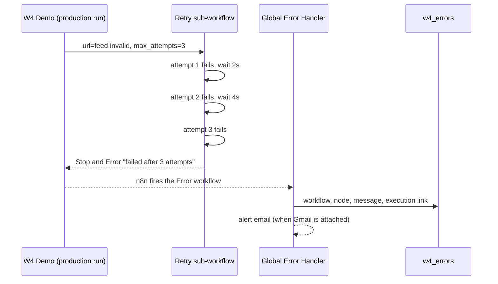

# W4: Error handling, retries and monitoring

Four workflows that make the others fail loudly and visibly:

| Workflow | What it does |
|---|---|
| **W4 - Global Error Handler** | Error Trigger. Set as the *Error workflow* of W1, W2, W5 and the demo job. Logs workflow, node, message and an execution link to `w4_errors`, then emails an alert. |
| **W4 - HTTP Retry with Backoff** | Reusable sub-workflow. Inputs `url`, `method`, `max_attempts` (1-5). Waits 2s, 4s, 8s between attempts. Returns `{ok, attempts, status, body}`, or stops with an error so the caller fails. |
| **W4 - Health Check** | Hourly. Checks that W2 reported within 26h with status `ok` and that no workflow errors were logged in 24h. Every check goes to `w4_health`; problems send one alert. |
| **W4 Demo - Flaky Job** | Webhook `GET /webhook/w4-flaky-demo?mode=ok|fail`. Calls the retry sub-workflow against a healthy URL or a host that doesn't exist, so a real production failure can be shown on demand. |

## How a failure travels

## Data tables

- `w4_errors`: occurred_at, workflow_name, workflow_id, node, message, execution_id, execution_url, mode
- `w4_health`: checked_at, status, w2_last_run_at, w2_age_hours, w2_last_status, errors_24h, problems

## Setup (about 15 minutes)

1. Create the two data tables.
2. Import the four JSON files from `workflows/`.
3. Publish **W4 - Global Error Handler** and **W4 - HTTP Retry**. n8n only runs a published error workflow, and production callers use a sub-workflow's published version.
4. In **W4 Demo - Flaky Job**, replace `REPLACE_WITH_W4_RETRY_WORKFLOW_ID` (the Execute Sub-workflow node) and pick the error handler in workflow settings. Do the same *Error workflow* setting on W1, W2 and W5.
5. Optional: attach Gmail to the alert nodes and **enable** *Gmail: Failure Alert*. It ships disabled, because n8n refuses to publish a workflow with a node that's missing a credential.

## Test results (2026-10-25)

| Exec | Test | Result | Pass |
|---|---|---|---|
| 11 | Retry sub-workflow vs `httpbin.org/status/503` | 3 attempts, 9.2s total (2s + 4s backoff), then the error "failed after 3 attempts. Last error: HTTP 503" | yes |
| 12, 18 | Retry vs a healthy USGS endpoint | success on attempt 1, body returned (18 is after fixing text bodies) | yes |
| 13 | **Production** run of the demo job, `mode=fail` | job failed after 3 retries; Global Error Handler fired by itself and wrote a `w4_errors` row (workflow, node `Fail: Retries Exhausted`, message, execution link) | yes |
| 16 | Production run, `mode=ok` | success, "Upstream OK after 1 attempt(s), status 200" | yes |
| 19 | Health check with default config | `unhealthy`: "1 workflow error(s) in the last 24h" (the real error from exec 13) | yes |
| 20 | Health check with error allowance 5 | `healthy` | yes |
| 21 | Health check with a 0.05h freshness limit | `unhealthy`: "W2 last ran 0.2h ago (limit 0.05h)" | yes |

The broken-credential case from the handover was exercised as a broken URL (exec 13). A broken credential fails the same way (the node throws, so the error workflow fires), but it wasn't run separately.

## Known limits

- n8n fires error workflows only for production runs (webhook or schedule), not manual test runs.
- Alert emails were not sent (no Gmail credential): *Gmail: Failure Alert* is disabled, and the health-check alert was pinned in tests.
- The health check isn't published, so it doesn't run hourly yet: its Gmail node has no credential, and publishing would refuse. Attach Gmail, then publish.
- The health check only knows about jobs that write a report row (W2). Event-driven W1 is covered by the error handler, not by freshness.
