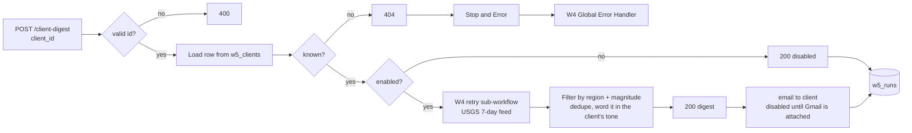

# W5: Per-client configuration ("a new client is a new row, not new code")

One webhook serves every client. Each client's behaviour comes from the `w5_clients` data table: region, magnitude threshold, tone of voice, item limit, notification email, and an on/off switch.

## Flow

## Config table `w5_clients`

| column | example | effect |
|---|---|---|
| client_id | `acme-ph` | key in the request |
| name | Acme PH Insurance (sample) | used in the greeting |
| notify_email | ops@acme.example | digest recipient (sample domains only) |
| enabled | true | `false` = respond `disabled`, fetch nothing |
| min_mag | 4.0 | magnitude threshold |
| region_name, min_lat, max_lat, min_lon, max_lon | Philippines, 4, 21.5, 116, 127 | bounding box |
| tone | formal / casual | wording of the summary |
| max_items | 5 | how many events to list |

All client rows are fictional samples.

## Setup (about 10 minutes)

1. Create `w5_clients` (columns above) and `w5_runs` (run_at, client_id, status, matched, min_mag, region_name, execution_id).
2. Import `workflows/w5-client-digest.json`. Replace `REPLACE_WITH_W4_RETRY_WORKFLOW_ID` in **Fetch Feed via W4 Retry**, and set the workflow's Error workflow to the W4 handler.
3. Publish, then `POST /webhook/client-digest` with `{"client_id": "acme-ph"}`.

## Test results (2026-10-25): production webhook runs, live USGS data

| Exec | Request | Result | Pass |
|---|---|---|---|
| 22 | `acme-ph` | formal, Philippines, M4+: 5 events, strongest M5.2 68 km NE of Cabatuan | yes |
| 24 | `globex-global` | casual, worldwide, M5.5+: 18 events; one event listed twice → fixed | found a bug |
| 26 | `umbrella-paused` | `disabled`, no fetch, logged | yes |
| 27 | `initech-jp` (no row yet) | 404; W4 Global Error Handler logged "Unknown client_id 'initech-jp' - no row in w5_clients" | yes |
| — | **added one row** for `initech-jp` (Japan, M3+, casual); **no workflow edit** | | |
| 29 | `initech-jp` again | casual Japan digest: 11 events | yes |
| 31 | `globex-global` after the dedupe fix | 17 events, duplicate gone | yes |
| 33 | `Bad ID!` | 400 | yes |

The dedupe fix (exec 24 → 31) was a code change, made before the new-client test. The new-client step itself touched only the data table.

## Known limits

- The webhook has no auth here: it only returns public quake data for a known client id. In production, add Header Auth like W1.
- The digest email node is disabled (no Gmail credential), so delivery was not tested.
- Region is a lat/lon box, not a polygon; a box around the Philippines also catches some sea areas.
